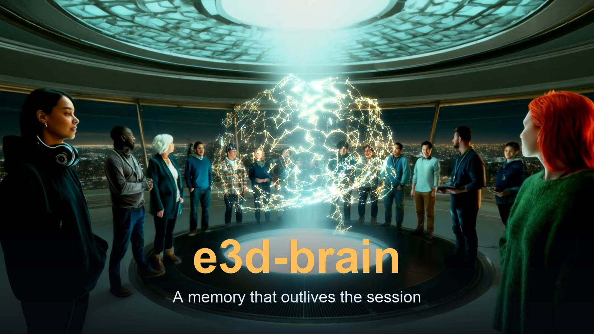
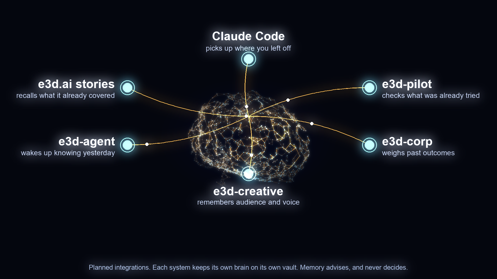

<p align="center">
  
</p>

<h1 align="center">e3d-brain</h1>

<p align="center"><b>A memory that outlives the session, and a mind that tidies it.</b></p>

<p align="center">
  <a href="https://www.youtube.com/watch?v=AmsJmRBiwiI">
    
  </a>
  <br>
  <a href="https://www.youtube.com/watch?v=AmsJmRBiwiI"><b>▶ Watch the concept film</b></a> (1:52)
</p>

Every AI session starts blank. Claude Code forgets last week's decision. An
agent repeats the mistake it made on Tuesday. A team re-explains what it
already settled. The records exist, in a ledger here and a log there, but the
people and agents doing the work can't *reach* them at the moment they matter.

`e3d-brain` is a small, local-first memory server that fixes that. It sits over
a plain folder of Markdown files (an [Obsidian](https://obsidian.md) vault),
speaks [MCP](https://modelcontextprotocol.io), and gives Claude and the E3D
agents **continuity**. A second layer, **cognition**, then looks after the
memory: it notices what was superseded, what is duplicated, what has gone
stale, and what real outcomes taught, and it proposes changes for a human to
accept.

Two ideas hold the whole thing together:

1. **Memory is advisory, never authority.** It retrieves and interprets history, with
   citations. It can never approve, spend, sign, or publish anything.
2. **Models propose; humans decide.** Nothing becomes permanent memory, and no
   existing note changes, until a person says yes. Every change is undoable.

---

## Status

Both layers are built from the specs in this repository, phase by phase, and
tested.

| | |
|---|---|
| **Memory layer** | 15 phases built ([`docs/e3d-brain-spec.md`](docs/e3d-brain-spec.md)) |
| **Cognition layer** | 9 phases built ([`docs/e3d-brain-cognition-spec.md`](docs/e3d-brain-cognition-spec.md)) |
| **Tests** | 664 passing, plus 24 per-phase verification scripts |
| **Verified on** | macOS (Apple silicon). **Not yet run on Linux.** |

What is *not* done, so you can judge it fairly:

- **No security review.** The code was written by AI and checked by tests and
  by independent model reviews of the design, not by a human security audit.
- **Not yet connected to real clients or the rest of the ecosystem.** The tests
  drive the real MCP server over stdio, but no one has yet used it from Claude
  Code day to day, and the integrations described below are planned, not live.
- **Not yet proven useful.** It is built to measure whether the cognition jobs
  earn their keep (see below); it has not yet run long enough on real data to say.

## Where it fits

Memory is not the record. It is the *reader* of the record.

| System | Keeps | Remains the authority for |
|---|---|---|
| **e3d-corp** | Business events: proposals, approvals, spend, outcomes | The business record |
| **e3d-pilot** | The idea ledger: specs, debates, PRs, verified results | The engineering record |
| **e3d-brain** | Notes that point back to both | *Nothing.* It helps retrieve and interpret |

<p align="center">
  
</p>

Each consumer runs its **own brain** on its own vault. There is no shared
server and no cross-brain data flow. The picture above shows the plan: these
integrations are not built yet.

| Consumer | Best use of the brain | What it contributes back |
|---|---|---|
| **You and Claude Code** | Resume work with current decisions, rationale, open questions, and rejected approaches | Proposed decisions and discoveries |
| **e3d-pilot** | Recall previous attempts, constraints, and lessons before drafting a spec | References to specs, commits, failures, verified results |
| **e3d-corp** | Retrieve company priorities and lessons when evaluating opportunities | Evidence exports linking proposals, actions, and outcomes |
| **e3d-creative** | Retrieve audience knowledge, brand voice, past concepts, and supported claims | Creative rationale and later campaign results |
| **e3d-agent** | Keep continuity between runs and recall relevant experience | Its own bounded, expiring journal |
| **e3d.ai stories** | Recall prior coverage, recurring entities, and open questions | Story references and corrections (fresh chain data is supplied separately) |

An agent can connect to several brains at once: a private journal, a read-only
playbook curated by humans, and a team brain it may only *propose* into.

## The memory layer

**What goes in.** Notes you write in Obsidian; direct captures made by you,
Claude, or an agent; Claude Code transcripts and Claude.ai / ChatGPT exports
(scrubbed into a raw archive); books as EPUB, Markdown, or text (searchable with
chapter-level citations, never stored in the vault); and an agent's existing
workspace files.

**What comes out.** Ranked search, over a rebuildable SQLite index (BM25, with
optional local embeddings). Every result carries a stable `id`, a revision
(`rev`), its lifecycle `status`, and a citation pinned to that exact revision
(`note:<id>@<rev>`), so a citation can be checked for staleness.

**The MCP tools** (read tools in every mode; write tools only where the mode
allows):

| Tool | Does |
|---|---|
| `search`, `read_note`, `list_notes`, `related` | Retrieve, with `as_of` time filters, status filters, size caps |
| `read_ref_chunk` | Read one passage of a book, by citation |
| `capture`, `list_inbox` *(inbox mode)* | Propose a note into the review inbox |
| `journal_append`, `journal_list` *(journal mode)* | An agent's own append-only, expiring journal |
| `report_use` | Record that a recalled note helped (feeds cognition) |

**Three modes**, fixed by config and never by a tool argument:

| Mode | For | MCP can write |
|---|---|---|
| `inbox` | A person's Claude | Proposals into `_inbox/` only |
| `journal` | An autonomous agent's own brain | New files under `journal/<agent>/` only |
| `read-only` | Anyone reading a curated brain | Nothing |

No tool in any mode can accept, promote, edit, move, or delete a note.
Accepting is a human action: the CLI, or moving the file in Obsidian.

## The cognition layer

A filing cabinet becomes a brain when it can notice what it holds. Cognition is
a set of **owner-run jobs** that read a brain and write **proposals** (typed,
cited, previewable). Nothing is applied by a job, and no MCP tool can start one.

| Job | Asks | Proposes |
|---|---|---|
| `supersede` | Did a newer decision replace an older one? | Mark the old note superseded, citing both with verbatim quotes |
| `consolidate` | Which notes are duplicates, or one idea in pieces? | Merge, or a cited summary; works without embeddings |
| `reflect` | What did real outcomes teach us? | Lessons whose citations must resolve to real thesis/outcome records |
| `forget` | What has gone stale and unused? | Demote or archive (never delete) |
| `gaps` | What do we keep asking about and know little of? | A gap report from the query log (opt-in) |

**The review queue** is where a human stays in charge:

```bash
ebrain review list            # typed proposals, with authentication and taint
ebrain review diff <id>       # the exact change against the current notes
ebrain review accept <id>     # revision-checked, crash-safe, undoable
ebrain review reject <id>     # remembered, so it is not proposed again
ebrain review undo <id>       # restores what accept changed
```

Safety, enforced by tests:

- **Closed change grammar.** A proposal can only contain a short list of typed
  operations. Its targets, evidence, and key cannot be altered after the run.
- **Authenticated.** `accept` applies only proposals recorded by a real job run,
  so a hand-forged file, or a `capture` that imitates one, is refused.
- **Crash-safe and undoable.** Apply is a transaction with a recovery path; every
  change is saved in a machine-local undo store.
- **Grounded.** A lesson citing an unknown outcome, or containing a number that
  is not in the cited records, is dropped. Lessons derived from untrusted
  sources carry that taint into review.
- **No scores as facts.** Proposals say `confidence: unrated`. Counters are
  observed events only.
- **Budgeted.** Every run has caps on calls, input, and proposals, and a flood
  limit on the pending queue.

**Does it earn its keep?** Each job reports its acceptance rate, and
[`docs/COGNITION-EVAL.md`](docs/COGNITION-EVAL.md) writes the kill criteria down
in advance (for example, a job whose acceptance rate falls below 30% over its
last 50 reviewed proposals should be switched off). `ebrain cognition report
--check` exits non-zero when one does, so a cron job can alert. Jobs can run in
`--shadow` mode, or be replayed against your own git history, to be evaluated
before they ever create review work.

## What makes it safe to trust

- **One module owns every filesystem path**, with realpath containment against
  traversal and symlink escape.
- **No network by default.** No telemetry, no update checks, no runtime installs.
  Anything non-loopback needs an explicit allowlist; sending text to a cloud
  model needs a per-run flag.
- **Secrets are scrubbed before anything is written, indexed, or embedded.** For
  agent principals, a write containing a private key, mnemonic, or API key is
  rejected whole.
- **Retrieved text is fenced, size-capped, and labeled as untrusted** reference
  data, so a note cannot instruct the model that reads it.
- **Everything is audited**, one line per call, without note bodies or query text.
- **It is plain files.** Open any brain in Obsidian and read exactly what an
  agent has recorded. Put the vault in git for diff and rollback.

## Quick start

```bash
npm ci --ignore-scripts
npm run build:native      # the one documented native build (better-sqlite3)
npm run build
npm test                  # 664 tests

node dist/src/cli/main.js init --vault ~/Brain --principal you
node dist/src/cli/main.js doctor --strict
```

### Try it in five minutes

```bash
node dist/src/cli/main.js init --vault ~/Brain --principal you      # prints the MCP snippet and writes a config
mkdir -p ~/Brain/notes
printf '# Why we chose Postgres\n\nPostgres over MySQL for JSONB and row-level security.\n' > ~/Brain/notes/postgres.md
export EBRAIN_CONFIG=<the config path init printed>
node dist/src/cli/main.js reindex
node examples/search-eval/ask.mjs "why did we pick postgres"          # same search an MCP client calls
```

Then register the server with Claude using the snippet `init` printed, and ask Claude the same question.
To score search quality on your own notes, write questions and the notes that should answer them,
then run `examples/search-eval/eval.mjs` (see the comments at the top of that file).

`init` prints the snippet to register the server with Claude Code or Claude
Desktop. A first cognition run, with nothing applied until you say so:

```bash
ebrain ids assign --dry-run               # cognition works on notes with assigned ids
ebrain cognition run supersede --dry-run
ebrain cognition run consolidate --max-proposals 10
ebrain review list
```

Requirements: Node 22 or later, and a C++ toolchain only if the prebuilt SQLite
binary for your platform is missing. Obsidian is an **optional** viewer on a
desktop and is never needed on a server. Full setup, configuration, agent
setups, scheduling, and running on a Linux server are in
[`docs/SETUP.md`](docs/SETUP.md).

## How it was built

The system was designed as two phased specs and built phase by phase by AI
(`e3d-code`, one fresh model session per phase), with each phase's tests
re-run independently before it was committed. Before any code existed, each
spec went through multi-model design debates (Claude and Codex, two rounds
each) that found real flaws: a scrubber ordered after the writer that needed it,
an audit log scheduled after the first runnable server, a "never overwrite"
write that used an overwriting rename, a promised regex timeout that cannot be
implemented in synchronous JavaScript, and, in the cognition spec, an undo
manifest that could not represent created or moved files. The transcripts are in
[`docs/debates/`](docs/debates/).

## Documents

- [`docs/SETUP.md`](docs/SETUP.md): install, configuration, MCP, scheduling, agents, Linux
- [`docs/SECURITY.md`](docs/SECURITY.md): the invariants
- [`docs/RANKING.md`](docs/RANKING.md): how results are ordered
- [`docs/COGNITION-EVAL.md`](docs/COGNITION-EVAL.md): measuring cognition jobs and when to turn them off
- [`docs/DEPENDENCIES.md`](docs/DEPENDENCIES.md): every dependency, justified
- [`docs/e3d-brain-spec.md`](docs/e3d-brain-spec.md) and [`docs/e3d-brain-cognition-spec.md`](docs/e3d-brain-cognition-spec.md): the specs
- [The concept film](https://www.youtube.com/watch?v=AmsJmRBiwiI) (1:52, on YouTube), and [`docs/video/`](docs/video/) for its script and production notes

The header animation and the ecosystem picture are generated by
[`docs/assets/render_brain.py`](docs/assets/render_brain.py) and
[`docs/assets/render_ecosystem.py`](docs/assets/render_ecosystem.py)
(procedural; no paid services).

## License and credits

[MIT](LICENSE), copyright 2026 FutCo LLC. Use it, change it, sell it; just keep
the copyright notice and license text with it.

**Created, directed, and funded by [Chris Bloom](https://www.youtube.com/@spaceyacey1).** Built with AI: Claude wrote
the software and the specs under Chris's direction, with design reviews by Claude and Codex. If you build on it,
a mention is appreciated.
